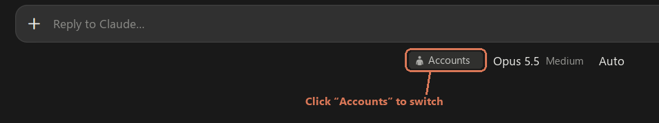
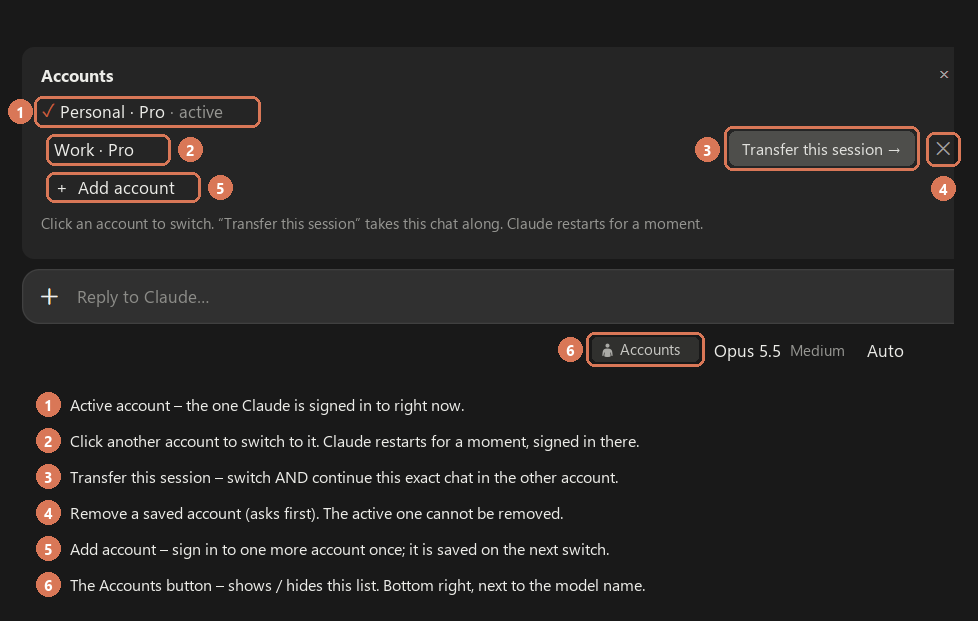

# Hotswitch – account switcher for the Claude Desktop app (Windows)

**Switch the Claude Desktop app between several Claude accounts with one click – no signing in again, no 2FA every time.**
Like the account switcher in the Claude iPhone/iPad app, but for **Claude Desktop on Windows**. You can even **take the current Claude Code session along** to the other account: same chat, same working folder, same history.

> ⚠️ **Unofficial.** Not made by, affiliated with or endorsed by Anthropic. It works with internal files and links of the Claude Desktop app that can change with any update. Use at your own risk and respect [Anthropic's terms](https://www.anthropic.com/legal/consumer-terms) for your accounts.

<p align="center">
  <br>
  <em>Where to find it: the <b>Accounts</b> button, bottom right under the prompt, next to the model name. Click it to see your accounts above the prompt.</em>
</p>

## What it does

| | |
|---|---|
| **Switch accounts** | One click on another account: Claude Desktop restarts for a moment, signed in to that account. |
| **Transfer this session** | Switches *and* opens the current Claude Code session in the other account – the whole chat, tool calls and context, via the app's own `claude://resume` link. |
| **Add account** | Signs out once so you can sign in to the next account (Google, e-mail link, …). It is saved automatically on the next switch. |
| **Remove** | ✕ next to an account, with a confirmation. The signed-in account cannot be removed. |
| **Your language, your theme** | Texts in 17 languages (follows Claude's language setting); colors follow light/dark mode. |
| **Safe** | Knows each login by its account id, keeps a snapshot and rolls back if a switch fails, runs one switch at a time. Logins never leave your PC. |

Typical use: two Claude Pro subscriptions (e.g. personal and work) on one Windows PC with the Claude Desktop app.

## Install

**Requirements:** Windows 10/11, the [Claude Desktop app](https://claude.ai/download) (Microsoft Store or classic installer) with a paid plan that has Claude Code (Pro/Max/Team), PowerShell 7 (the installer offers to install it).

### Option A – click

1. [Download this repository as ZIP](https://github.com/Kessler833/claude-hotswitch/archive/refs/heads/main.zip) and unpack it.
2. Double-click **`install.cmd`**.
3. Quit Claude Desktop completely and open it again.

### Option B – one line in a terminal Claude Code session

```
/plugin install hotswitch --marketplace Kessler833/claude-hotswitch
```

Answer `y` to add the marketplace, then pick the user scope. Or from a shell:

```bash
claude plugin marketplace add Kessler833/claude-hotswitch
```
```bash
claude plugin install hotswitch@hotswitch
```

### Option C – let your AI agent do it

Tell Claude Code (or any coding agent with a shell): *“Install Hotswitch from github.com/Kessler833/claude-hotswitch.”* Step-by-step instructions for agents are in [AGENTS.md](AGENTS.md).

## First use

1. Open a **Code** session in Claude Desktop and send a message (plugins only run inside a started session).
2. Bottom right, next to the model name: click **👤 Accounts**.
3. Click **+ Add account** – Claude restarts signed out. Sign in to your second account (the last time you need 2FA).
4. Click **👤 Accounts** again and click your first account. Both are saved now.

<p align="center">
  <br>
  <em>The account list (illustration, account names are examples).</em>
</p>

From then on: **👤 Accounts → click an account.** Or **Transfer this session →** to continue the current chat in the other account (handy when one account's usage limit is reached).

Commands: `/account` (show/hide), `/account list`, `/account <name>`, `/account transfer <name>`, `/account new`, `/account label <name> <text>`, `/account delete <name>`, `/account help`.

## How it works

Claude Desktop keeps its sign-in in two places inside its data folder: the cookie database `Network\Cookies` and the login entries in `config.json` (`oauth:tokenCache`, `oauth:tokenCacheV2`, `lastKnownAccountUuid`). Everything else – settings, Claude Code sessions, chats on disk – is the same for every account.

Hotswitch saves exactly those login parts per account (in `%LOCALAPPDATA%\claude-hotswitch\profiles`) and swaps them:

1. The plugin (a Claude Code *mod*: a hooks module that draws the button and the list) starts `scripts\launch.ps1` detached via WMI, so it survives Claude closing.
2. `scripts\hotswitch.ps1` closes Claude Desktop (the cookie file is locked while it runs), saves the signed-in login under its account (matched by account id), puts the target account's login in place – with a snapshot and rollback – and starts Claude again through a `claude://` link (`claude://code/new`, or `claude://resume?session=<id>` for a transfer).
3. `scripts\whoami.ps1` reads the name shown bottom-left (“Name · Pro”) via Windows UI Automation to label accounts – no screenshots, no credentials.

Sessions are shared between accounts: the transcript lives in `~/.claude/projects/…/<session-id>.jsonl`; a transfer only makes the other account's sidebar import it.

## Limits

- **Windows only.** Tested with the Microsoft Store version of Claude Desktop; the classic installer is supported but less tested.
- **Restart on every switch** (a few seconds). A running answer stops.
- The **Accounts** button lives in the prompt footer, which gives plugins an 18 px line – so it is small. The app's own account menu cannot be extended by plugins.
- The button appears in a **Code session after its first message**, not on the empty start screen.
- Normal claude.ai chats are not Claude Code sessions and cannot be transferred.
- Built on undocumented internals of Claude Desktop: an update can break it. Please open an issue.

## Uninstall

```bash
powershell -NoProfile -ExecutionPolicy Bypass -File uninstall.ps1
```

Add `-RemoveSavedLogins` to also delete `%LOCALAPPDATA%\claude-hotswitch`.

## Development

```bash
pwsh -NoProfile -File tests/run-tests.ps1
```

38 checks on fake data (dummy tokens, a fake `config.json`): switching, signing in by hand, unsaved accounts with equal names, broken saved logins, rollback after a failure mid-switch, the run lock, transfers, deleting, labels, an empty start, log size. The plugin itself is `hooks/register.tsx`; texts are in `i18n/` (English source `en.json`, all languages `all.json`, embedded between `BEGIN STRINGS` / `END STRINGS`).

## Keywords

Claude Desktop account switcher · switch Claude accounts · multiple Claude accounts · Claude multi-account Windows · two Claude Pro accounts · Claude Code plugin / mod · Claude Desktop hotswitch · Claude login switcher · continue Claude Code session in another account

## License

[MIT](LICENSE) © Kessler833
